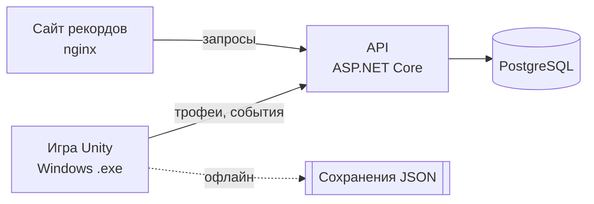

<div align="center">

# 🎣 Омут

**Рыбалка днём. Выживание ночью. Правда на дне.**

2D-игра про рыбалку с мистикой на озере в белорусском Полесье.
Групповой проект по ТРПО, группа ПО-2409.


</div>

---

## Об игре

Сымон получает в наследство от деда Язэпа, пропавшего 3 года назад, хату и старый баркас у озера рядом с деревней Тихие Вирки. На причале стоит запертый сундук деда, а из его дневника вырваны страницы. Правило озера простое: в 20:00 бьёт колокол маяка, и после него безопасно только у света.

**Днём** озеро спокойное: ловишь карасей и щук, продаёшь улов Тарасу, копишь на новую лодку.
**Ночью** опускается туман: клюют светящиеся мутанты, растёт паника, а на дне рифа лежат сундучки со страницами дневника. Соберёшь все 5, и узнаешь, что случилось с дедом и кто такой Хозяин Омута.

Действующий план игры: [docs/PLAN.md](docs/PLAN.md). Первая версия идеи: [docs/CONCEPT.md](docs/CONCEPT.md).

## Главные механики

| | Механика | Коротко |
|---|---|---|
| 🚤 | Лодка | движение с инерцией, урон от камней и коряг |
| 🎯 | Заброс | видимые круги на воде, сила броска по зажатию `Space` |
| 🐟 | Вываживание | шкала натяжения и прогресса, у каждой рыбы свой характер |
| 🧩 | Трюм-сетка | рыбы-прямоугольники разного размера, перетаскивание и поворот |
| 🌙 | День и ночь | колокол в 20:00, туман, фонарь, керосин, ночная рыба дороже в 3 раза |
| 😨 | Паника | шёпот, ложные поклёвки, руль слушается хуже, обморок |
| 📓 | Журнал | 14 записей, дневник деда, квесты |
| 🔧 | Лодки | три лодки у Михалыча: быстрее, больше трюм, крепче, эхолот |
| 🏆 | Онлайн-рекорды | трофеи группы на сайте, сервер в Docker |

## Команда

| Участник | Роль | Зона ответственности |
|---|---|---|
| **Илья** | Тимлид | задачи и сроки, ревью кода, баланс, сборка уровней, проверка арта |
| **Ярослав** | Разработчик | вся логика игры, сервер, сайт, Docker, репозиторий |
| **Ульяна** | Дизайнер | персонажи, лодки, рыбы, предметы, иконки, интерфейс, анимации |
| **Лиза** | Дизайнер | тайлы зон, окружение, свет и туман, звук и музыка, логотип |
| **Сарина** | Тестировщик, документовед | ТЗ, диаграммы, тест-кейсы, баги, тексты диалогов и записок, презентация |

Подробно: [docs/TEAM.md](docs/TEAM.md), план каждого по патчам: [docs/TEAM_PLAN.md](docs/TEAM_PLAN.md)

## Стек

| Часть | Технологии |
|---|---|
| Игра | Unity 6.3 LTS (**6000.3.28f1**), 2D URP, C#, Tilemap, 2D Light, ScriptableObject, сохранения в JSON |
| Сервер | ASP.NET Core Web API, PostgreSQL, JWT |
| Сайт рекордов | HTML, CSS, JS, nginx |
| Запуск | Docker Compose |
| Работа в команде | GitHub (организация omut-team), Projects (Kanban), Issues, Pull Requests, Git LFS |
| Тесты | Unity Test Framework, xUnit, ручные тест-кейсы |

## Архитектура



Игра полностью работает без интернета. Сервер добавляет аккаунты, доску трофеев и статистику.

## Структура репозитория

```
omut/
├── game/        Unity-проект (Unity 6000.3.28f1)
├── server/      API на ASP.NET Core (.NET 10)
├── web/         сайт рекордов (nginx)
├── docker-compose.yml   сервер + база + сайт одной командой
├── design/      арт: исходники (src/) и готовые PNG для игры (export/)
├── docs/        идея, ТЗ, диаграммы, тесты, инструкции
└── .github/     шаблоны задач и pull request'ов
```

## Быстрый старт

Первый раз? Пошаговая инструкция для Windows: **[docs/SETUP.md](docs/SETUP.md)**

```bash
git clone https://github.com/omut-team/omut.git
cd omut
git checkout dev
```

**Игра:** открыть папку `game` через Unity Hub (версия Unity строго **6000.3.28f1**, Windows 10/11 или macOS 13+).
Готовая игра собирается под Windows 10/11 (`.exe`). Требования к компьютеру: [docs/SETUP.md](docs/SETUP.md#часть-0-какой-нужен-компьютер).

**Сервер и сайт:**

```bash
docker compose up --build
```

Сайт: http://localhost:8080 · сервер: http://localhost:5000/api/health

## План (патчи)

- [ ] **0.1** (до 6.12.2026) лодка и камера, день, ночь и колокол, меню, пауза, настройки
- [ ] **0.2** (до 10.01.2027) рыбные места, заброс, вываживание, 4 вида рыбы, журнал
- [ ] **0.3** (до 14.02.2027) трюм, причал и Тарас, наживки, сохранения, квесты, три лодки, сервер
- [ ] **0.4** (до 21.03.2027) ночь, туман, паника, 4 зоны, дневник деда, звук, сайт рекордов
- [ ] **1.0** (до 25.04.2027) финал с Хозяином Омута, тесты, документация, презентация

22 этапа по шагам: [docs/PLAN.md](docs/PLAN.md). Кто что делает к каждому патчу: [docs/TEAM_PLAN.md](docs/TEAM_PLAN.md).

**Kanban-доска:** https://github.com/orgs/omut-team/projects/1 · [Issues](https://github.com/omut-team/omut/issues) · [Патчи](https://github.com/omut-team/omut/milestones)

## Как мы работаем

Ветки, коммиты, правила для сцен и арта: **[CONTRIBUTING.md](CONTRIBUTING.md)**

## Документы

| Документ | Где |
|---|---|
| **План разработки (главный)** | [docs/PLAN.md](docs/PLAN.md) |
| План каждого по патчам | [docs/TEAM_PLAN.md](docs/TEAM_PLAN.md) |
| Роли | [docs/TEAM.md](docs/TEAM.md) |
| Установка и кто куда коммитит | [docs/SETUP.md](docs/SETUP.md) |
| Гайд для дизайнеров | [docs/ART.md](docs/ART.md) |
| Тексты игры | [docs/texts/](docs/texts/) |
| Диаграммы | [docs/diagrams/](docs/diagrams/) |
| Тест-кейсы | [docs/tests/](docs/tests/) |
| Первая версия идеи | [docs/CONCEPT.md](docs/CONCEPT.md) |

---

<div align="center">
ПО-2409 · ТРПО · 2026
</div>
