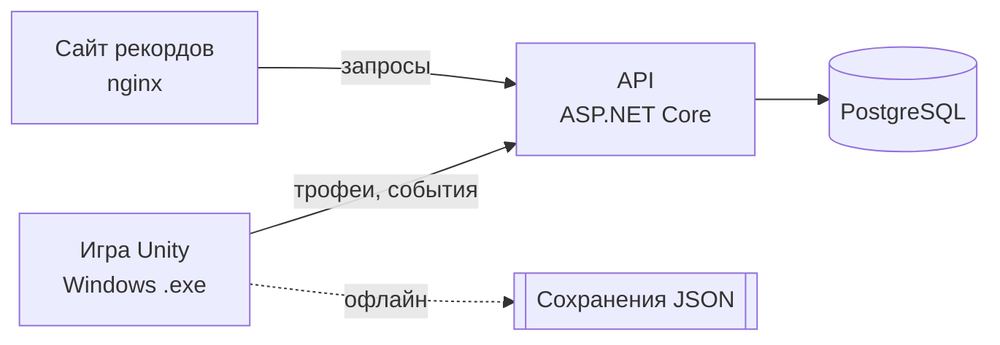

<div align="center">

# 🎣 Омут

**Рыбалка днём. Выживание ночью. Правда на дне.**

2D-игра про рыбалку с мистикой на озере в белорусском Полесье.
Групповой проект по ТРПО, группа ПО-2409.


</div>

---

## Об игре

Сымон получает в наследство от пропавшего дядьки Язэпа старую лодку и хату у озера рядом с деревней Тихие Вирки. Местные молчат и повторяют одно: *«После заката гаси огни и не смотри, что тянет леску»*.

**Днём** озеро спокойное: ловишь карасей и щук, продаёшь улов, улучшаешь лодку.
**Ночью** опускается туман: обычная рыба уходит на дно, поднимаются светящиеся мутанты, растёт паника, а со дна можно достать записки дядьки и узнать, что случилось на затопленной биостанции.

Полное описание идеи: [docs/CONCEPT.md](docs/CONCEPT.md)

## Главные механики

| | Механика | Коротко |
|---|---|---|
| 🚤 | Лодка | движение с инерцией, урон от камней и коряг |
| 🎯 | Заброс | сила броска по зажатию `Space` |
| 🐟 | Вываживание | мини-игра со шкалой натяжения, у каждой рыбы свой характер |
| 🧩 | Трюм-сетка | рыбы разного размера, приходится выбирать, что взять |
| 🌙 | День и ночь | туман, фонарь, керосин, ночная рыба дороже в 3 раза |
| 😨 | Паника | ложные поклёвки, шёпот, руль слушается хуже |
| 📓 | Журнал | пойманные виды, записки, квесты |
| 🔧 | Улучшения | двигатель, обшивка, прожектор, эхолот |
| 🏆 | Онлайн-рекорды | трофеи группы на сайте, сервер в Docker |

## Команда

| Участник | Роль | Зона ответственности |
|---|---|---|
| **Илья** | Тимлид, разработчик | задачи и сроки, ревью, рыбалка, трюм, NPC и квесты |
| **Ярослав** | Разработчик | ядро игры, лодка, день и ночь, сохранения, сервер, Docker, репозиторий |
| **Ульяна** | Дизайнер | персонажи, рыбы, предметы, иконки, интерфейс, анимации |
| **Лиза** | Дизайнер | локации, тайлсеты, окружение, свет и туман, звук и музыка |
| **Сарина** | Тестировщик, документовед | ТЗ, диаграммы, тест-кейсы, баги, тексты диалогов и записок, презентация |

Подробно: [docs/TEAM.md](docs/TEAM.md)

## Стек

| Часть | Технологии |
|---|---|
| Игра | Unity 6 LTS, 2D URP, C#, Tilemap, 2D Light, ScriptableObject, сохранения в JSON |
| Сервер | ASP.NET Core Web API, PostgreSQL, JWT |
| Сайт рекордов | HTML, CSS, JS, nginx |
| Запуск | Docker Compose |
| Работа в команде | GitHub (организация omut-team), Projects (Kanban), Issues, Pull Requests, Git LFS |
| Тесты | Unity Test Framework, xUnit, ручные тест-кейсы |

## Архитектура



Игра полностью работает без интернета. Сервер добавляет аккаунты, доску трофеев и статистику.

## Структура репозитория

```
omut/
├── game/        Unity-проект (появится в патче 0.1)
├── server/      API на ASP.NET Core (.NET 10)
├── web/         сайт рекордов (nginx)
├── docker-compose.yml   сервер + база + сайт одной командой
├── design/      исходники арта (.psd, .aseprite, .kra)
├── docs/        идея, ТЗ, диаграммы, тесты, инструкции
└── .github/     шаблоны задач и pull request'ов
```

## Быстрый старт

Первый раз? Пошаговая инструкция для Windows: **[docs/SETUP.md](docs/SETUP.md)**

```bash
git clone https://github.com/omut-team/omut.git
cd omut
git checkout dev
```

**Игра:** открыть папку `game` через Unity Hub (версия Unity: **будет указана в патче 0.1**).

**Сервер и сайт:**

```bash
docker compose up --build
```

Сайт: http://localhost:8080 · сервер: http://localhost:5000/api/health

## План (патчи)

- [ ] **0.1** меню, лодка, карта залива, день и ночь
- [ ] **0.2** заброс, вываживание, 4 вида рыбы, журнал
- [ ] **0.3** трюм, магазин, NPC, квесты, сохранения, сервер в Docker
- [ ] **0.4** ночь целиком: туман, паника, мутанты; звук, сайт, остальные локации
- [ ] **1.0** финал, тесты, документация, презентация

**Kanban-доска:** https://github.com/orgs/omut-team/projects/1 · [Issues](https://github.com/omut-team/omut/issues) · [Патчи](https://github.com/omut-team/omut/milestones)

## Как мы работаем

Ветки, коммиты, правила для сцен и арта: **[CONTRIBUTING.md](CONTRIBUTING.md)**

## Документы

| Документ | Где |
|---|---|
| Идея проекта | [docs/CONCEPT.md](docs/CONCEPT.md) |
| Роли | [docs/TEAM.md](docs/TEAM.md) |
| Установка | [docs/SETUP.md](docs/SETUP.md) |
| Гайд для дизайнеров | [docs/ART.md](docs/ART.md) |
| ТЗ, диаграммы, тест-кейсы | [docs/](docs/) (пополняется) |

---

<div align="center">
ПО-2409 · ТРПО · 2026
</div>
